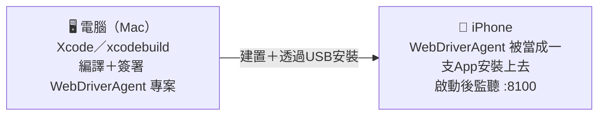
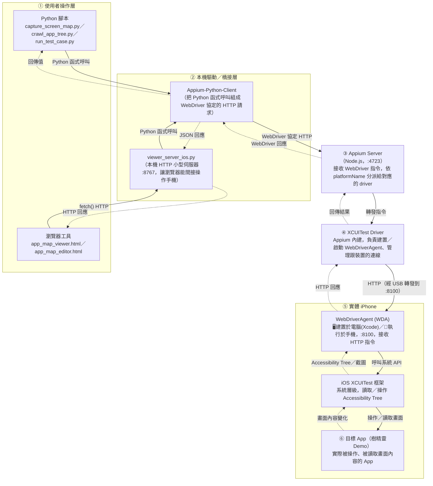
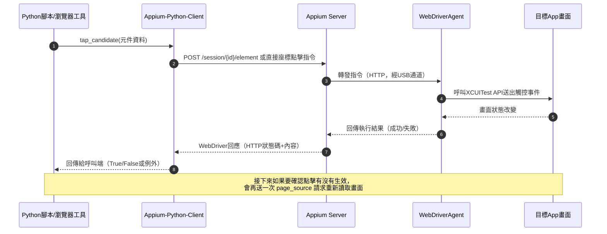

# 自動化測試架構：從腳本到手機的資料流程

> 說明整個專案的自動化測試怎麼運作——不管是直接跑 Python 腳本
> （`crawl_app_tree.py`／`run_test_case.py`），還是透過瀏覽器工具
> （`app_map_viewer.html` 這類），最終都會匯流到同一條「Appium → WDA →
> 手機」的路徑上，只是進入點不同。

---

## 零、先搞清楚 WDA 在哪裡：建置在電腦，執行在手機

`WebDriverAgent (WDA)` 這個名字容易讓人以為是電腦上的程式，實際上要分兩個
階段看，**這個步驟發生在下面「整體架構圖」的資料流程開始之前**，是一次性
的準備動作，不是每次點擊/掃描都會重新做一次：

- **建置(編譯、簽署)動作在電腦上**：跟開發任何一支iOS App一樣，需要Xcode
  工具鏈
- **建置完成的產物，會被安裝到手機上變成一支真正的App**——執行位置是手機，
  不是電腦
- **跟目標App(樹精靈Demo)的關係**：兩支App都裝在同一支手機上，WDA是負責
  接收自動化指令、代為讀取畫面/送出點擊的「代理人」，目標App才是真正被
  操作的對象
- **這個步驟不是每次都重做**：簽署有效期內、WDA已經裝在手機上時，後續每次
  執行都是直接連線用，只有簽署過期或WDA需要重新編譯時才會觸發重新建置

---

## 一、整體架構圖

實線 = 指令往下送；虛線 = 結果／資料往回傳。

---

## 二、每一層在做什麼

| 層 | 元件 | 做什麼 |
|---|---|---|
| ① 使用者操作層 | Python 腳本 | 直接寫程式呼叫 Appium，適合批次掃描、爬蟲這類不需要人工即時操作的情境 |
| ① 使用者操作層 | 瀏覽器工具 | 給人工即時互動用（點截圖送點擊、聊天產生測案），但瀏覽器基於安全限制不能直接連 Appium |
| ② 橋接層 | Appium-Python-Client | 把「點這個元件」「讀取畫面」這類 Python 呼叫，翻譯成 WebDriver 協定規定的 HTTP 請求格式 |
| ② 橋接層 | viewer_server_ios.py | 本機小型伺服器，讓瀏覽器工具能用一般的 `fetch()` 呼叫，間接借用 Appium-Python-Client 操作手機 |
| ③ Appium Server | Appium Server | 標準化的中介層，接收 WebDriver 指令，依連線時宣告的平台（iOS/Android）分派給對應的driver去處理 |
| ④ Driver層 | XCUITest Driver | iOS 專用，負責在裝置上建置、簽署、啟動 WebDriverAgent，並維持跟它的連線 |
| ⑤ 裝置層 | WebDriverAgent (WDA) | 這是**裝在手機上、跟目標App一起跑的一支測試用App**，本身是蘋果官方 XCTest 框架的一部分，接收HTTP指令後轉呼叫系統API |
| ⑤ 裝置層 | iOS XCUITest 框架 | 作業系統層級的機制，真正去讀 Accessibility Tree、真正去送出觸控事件 |
| ⑥ 目標App | 樹精靈Demo | 被操作、被讀取畫面內容的對象，本身不知道自己正在被自動化測試 |

---

## 三、一個具體例子：點擊一個按鈕的完整往返

---

## 四、兩條進入路徑的差異

| | 直接跑Python腳本 | 透過瀏覽器工具 |
|---|---|---|
| 適合情境 | 批次掃描、爬蟲探索（不需要人在旁邊即時決策） | 人工即時操作、逐一檢視/送出點擊、對話式產生測案 |
| 誰握有Appium連線 | 腳本自己的 Python process | `viewer_server_ios.py` 這支常駐伺服器 |
| 多開會不會衝突 | 同時間只能有一個腳本連著同一台裝置 | 瀏覽器工具本身不連裝置，但底層一樣共用同一個Appium連線，一樣不能跟其他腳本同時跑 |
| 資料怎麼進來 | 腳本自己組webdriver指令 | 瀏覽器送一般HTTP請求給橋接伺服器，伺服器再轉成Appium呼叫 |

**共同點**：不管從哪個入口進來，一旦過了 Appium-Python-Client 這一關，後面「Appium Server → XCUITest Driver → WebDriverAgent → iOS系統 → 目標App」這條路完全一樣，這也是為什麼兩條路徑不能同時使用同一台裝置——它們最終都在搶同一個Appium連線資源。
